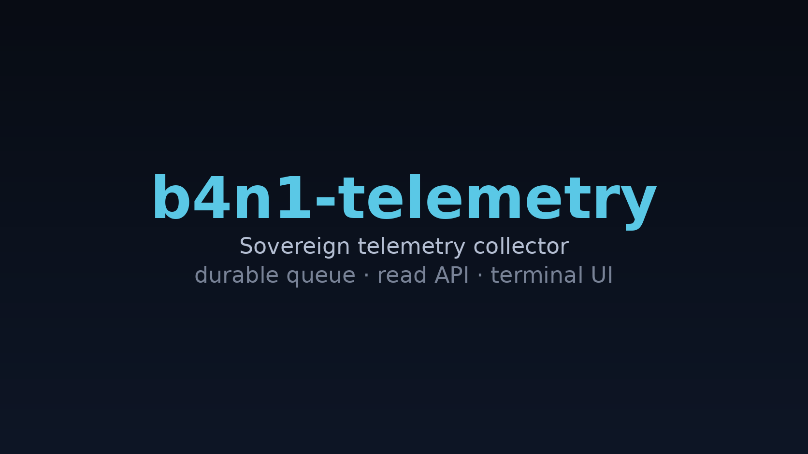

<p align="center">
  
</p>

<div align="center">

# 📊 b4n1-telemetry

**Sovereign telemetry. Events in, a durable queue on local disk, a read API and a terminal UI out — no SaaS account, no agent fleet, nothing leaving the machine.**

[English](README.md) · [Español](README.es.md) · [Deutsch](README.de.md) · [Français](README.fr.md) · [Italiano](README.it.md) · [Português (BR)](README.pt-BR.md) · [Русский](README.ru.md) · [العربية](README.ar.md) · [हिन्दी](README.hi.md) · [日本語](README.ja.md) · [한국어](README.ko.md) · [中文](README.zh-CN.md)

[English](README.md) · [Español](README.es.md) · [Deutsch](README.de.md) · [Français](README.fr.md) · [Italiano](README.it.md) · [Português (BR)](README.pt-BR.md) · [Русский](README.ru.md) · [العربية](README.ar.md) · [हिन्दी](README.hi.md) · [日本語](README.ja.md) · [한국어](README.ko.md) · [中文](README.zh-CN.md)

[](LICENSE)
[](https://pypi.org/project/b4n1-telemetry/)
[](https://www.npmjs.com/package/b4n1-telemetry)
[](https://www.nuget.org/packages/B4n1.Telemetry)
[](https://rubygems.org/gems/b4n1-telemetry)
[](https://packagist.org/packages/b4n1/b4n1-telemetry)
[](https://pkg.go.dev/github.com/B4N1-com/b4n1-telemetry/sdks/go)
[](https://github.com/B4N1-com/b4n1-telemetry)

</div>

---

## 📦 Installation — 6 registries, 1 wire contract

| Registry | Language | Package | Command |
|----------|----------|---------|---------|
| **PyPI** | Python 3.10+ | `b4n1-telemetry` | `pip install b4n1-telemetry` |
| **npm** | Node.js | `b4n1-telemetry` | `npm install b4n1-telemetry` |
| **NuGet** | .NET / C# | `B4n1.Telemetry` | `dotnet add package B4n1.Telemetry` |
| **RubyGems** | Ruby | `b4n1-telemetry` | `gem install b4n1-telemetry` |
| **Packagist** | PHP 8.1+ | `b4n1/b4n1-telemetry` | `composer require b4n1/b4n1-telemetry` |
| **Go** | Go 1.21+ | `b4n1-telemetry/sdks/go` | `go get github.com/B4N1-com/b4n1-telemetry/sdks/go` |

Every client speaks the same contract — `POST /api/v1/events` with a JSON array of envelopes and a bearer token — so the collector runs once and any of the six clients speaks to it.

---

## 🚀 Quick Start

```python
# Python
import b4n1_telemetry

b4n1_telemetry.init(app="checkout")
b4n1_telemetry.capture("payment failed", level="error", module="payments",
                       correlation_id="req-42")
b4n1_telemetry.flush()
```

```javascript
// Node.js
const telemetry = require('b4n1-telemetry');

telemetry.init({ app: 'checkout' });
telemetry.capture('payment failed', { level: 'error', module: 'payments', correlationId: 'req-42' });
await telemetry.flush();
```

```csharp
// .NET / C#
using B4n1.Telemetry;

Telemetry.Init(new Options { App = "checkout" });
Telemetry.InstallUncaughtHandlers();
Telemetry.Capture("payment failed", "error", "payments");
```

```ruby
# Ruby
require "b4n1_telemetry"

B4N1Telemetry.init(app: "checkout")
B4N1Telemetry.correlation_id = "req-42"
B4N1Telemetry.capture("payment failed", level: "error", component: "payments")
B4N1Telemetry.flush(2.0)
```

```php
// PHP
\B4n1\Telemetry\Telemetry::init(['app' => 'checkout']);
\B4n1\Telemetry\Telemetry::installErrorHandlers();
\B4n1\Telemetry\Telemetry::capture('payment failed', component: 'payments');
```

```go
// Go
import telem "github.com/B4N1-com/b4n1-telemetry/sdks/go"

telem.Init(telem.Options{App: "checkout"})
defer telem.Close()
telem.Capture("error", "payment failed", "payments", nil)
```

---

## ⚡ What it does

| Capability | What you get |
|------------|--------------|
| **Durable queue** | Events are written to the local store before they are acknowledged; a restart does not lose the batch you thought you sent. |
| **Real backtraces** | Frames are captured in-process, not reconstructed from log lines. |
| **PII scrubbing at ingest** | What is filtered before it lands cannot leak later. |
| **Causal chain** | One correlation id returns the whole path a request took, in order. |
| **Grouped issues** | Normalisation plus a measured similarity merge: precision 1.00 / recall 0.72 on the labelled corpus, pinned by the test suite. |
| **Bounded footprint** | The store compacts to a byte cap you set; a full run of 10 000 events measured 17 MiB resident. |
| **Self-hosted reading** | Query, issues, trace and stats over the same API the clients write to. |

---

## 🖥 Platform Support

| Platform | Architectures |
|----------|---------------|
| **Linux** | x86_64 (static, no runtime to install) |

The collector is one process with no external dependencies; the clients are thin wrappers over HTTP.

---

## 📄 License

Business Source License 1.1 — see [LICENSE](LICENSE) and [EULA.txt](EULA.txt).
